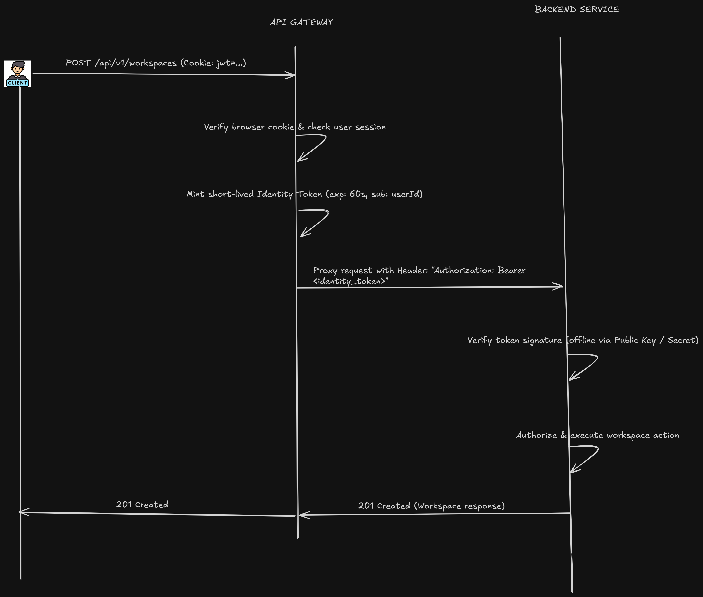

# DotConnect API Gateway

## Architecture

## Connecting the frontend and Go service

The frontend sends `/api/v1` requests to the gateway. For local Vite development,
set `VITE_API_URL=http://localhost:5000` in `frontend/.env.local` (this is also
the frontend default). The gateway handles `/api/v1/users` itself and proxies
`/api/v1/workspace` to the Go service.

Set `BACKEND_GO_SERVICE` to the Go service URL. It defaults to
`http://localhost:4000` for local gateway development; the gateway listens on
port `5000` locally. The Docker Compose
example uses `http://host.docker.internal:4000` to reach a Go service running on
the host. `INTERNAL_SECRET` must be set on the gateway and Go service to the
same value so the gateway can sign identity tokens the Go service will accept.
When using the Compose Nginx entry point, point the frontend at
`http://localhost` instead of port `5000`.
